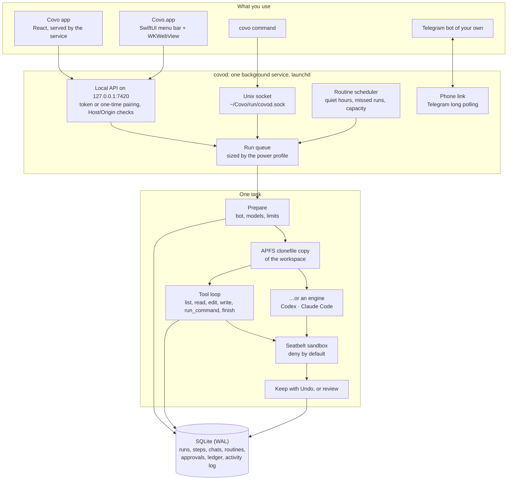

# How Covo works

This page describes what's built and running. [BLUEPRINT.md](BLUEPRINT.md) has the full design, the reasons behind each choice (the ADRs) and what's planned.

## The pieces



The code lives in a Bun workspace monorepo. Every package is strict TypeScript, and Biome handles linting.

| Package | What it holds |
|---|---|
| `apps/cli` | The `covo` command, plus the service: API, scheduler, phone link, subscriptions, the Library feed, the demo |
| `apps/app` | The React app, built by Bun's bundler, with light and dark design tokens from Figma |
| `apps/mac` | Covo.app in Swift: the menu bar, notifications, a WKWebView window, and starting the service |
| `packages/engine` | Runs, the tool loop, budgets, fallbacks, review, keep and undo, bots, routines, the daily summary, and the Codex and Claude Code engines with the network filter |
| `packages/models` | Model providers: Anthropic, OpenAI-compatible, Responses, Ollama. Also connections, prices, and Sign in with ChatGPT |
| `packages/sandbox` | Instant copies, undo snapshots, text diffs, sandbox self-checks |
| `packages/platform` | macOS behind interfaces: Seatbelt profiles, clonefile, the Keychain, system info |
| `packages/db` | Migrations and the hash-chained, append-only activity log |
| `packages/phone` | The Telegram Bot API client, pairing, message formats, a stand-in Telegram for tests |
| `packages/api` | The types the service and the app share |

## A task, start to finish

```mermaid
sequenceDiagram
  participant You
  participant Service as covod
  participant Engine as Run engine
  participant Box as Sandbox (workspace copy)
  participant AI as Your AI
  You->>Service: message in a bot's chat
  Service->>Engine: queue the task (capacity permitting)
  Engine->>Box: clonefile the workspace (instant, no extra space)
  loop each step
    Engine->>Engine: budget check before the model call
    Engine->>AI: the conversation so far
    AI-->>Engine: a tool call
    Engine->>Box: run the tool inside Seatbelt
    Box-->>Engine: result, or blocked (path or sandbox)
    Engine->>Engine: write the step and an activity-log entry
  end
  Engine->>Engine: diff the copy against your folder
  Engine-->>You: kept with Undo, or held for review
```

- **Instant copies.** `clonefile(2)` copies the workspace in constant time and shares blocks until a file changes. A finished task is diffed against the original. Keeping it saves an undo snapshot first. Undo refuses any file you've changed since, so your own work is never overwritten.
- **Levels.**
  - *Supervised:* changes wait for your review.
  - *Automatic* (the default): changes are kept, with Undo.
  - *Fully automatic:* changes are kept, and the bot stops at its limit instead of asking.
- **Fallbacks.** A bot lists its models in order. A usage cap, a sign-in problem or an outage hands the task to the next model, in the same copy, with a note about what was already done.
- **Spending.** Every model call is estimated before it's sent, from the price table or your own prices. Going over a task or day limit pauses the task until you answer, in the app, the menu bar, your phone or the terminal. Subscriptions and local models cost $0.

## The sandbox

Each command a bot runs goes through `/usr/bin/sandbox-exec` with a generated profile.

- **Reads:** the system folders, the workspace copy and the task's temp folder. Never your home folder: SSH keys, documents and Covo's own data are invisible. `/Library/Keychains` is always denied.
- **Writes:** the workspace copy and the temp folder only.
- **Network:** none for a bot's own commands.
- **Engines,** the official command-line programs that use your plan, get a profile of their own:

| | Claude Code | Codex |
|---|---|---|
| Tools | File tools only, no shell | A shell (it reads files by running commands) |
| Network | Allowed (it has no shell to misuse it) | Only `localhost:<filter>`. The filter tunnels HTTPS to `*.openai.com` and `*.chatgpt.com` only. DNS is blocked. |
| Its own sign-in | Its own Keychain entry | `~/Covo/engines/codex/auth.json`, in Covo's own Codex folder |
| Settings it ignores | The workspace's `.claude` folder, MCP servers, slash commands | Your `~/.codex` settings and rules, ChatGPT apps, plugins, analytics |

The tests run the real sandbox every time:

- [injection.test.ts](../packages/engine/src/injection.test.ts) uses a model that obeys a planted note. Reading an SSH key, raising limits in the settings file and the database, and uploading a file are all refused, logged, and change nothing.
- [codex.test.ts](../packages/engine/src/codex.test.ts) uses a stand-in Codex. It can't reach the internet, neither through the filter nor around it.

## The activity log

Each entry is canonical JSON, and its hash covers the hash of the entry before it. Triggers make the SQLite table append-only. `covo audit verify` (and the Library's banner) walks the chain and reports the first entry that was changed, removed or reordered. The service logs refusals too: requests to the API without a valid sign-in, messages from strangers on Telegram, stale approvals. Repeats are throttled, so the log can't be flooded.

## The service and its API

- **Launchd:** `covo service install` registers a launchd agent. It keeps the service running and restarts it after a crash. A run left behind by a dead process is marked failed at the next start.
- **Who may call it:**
  - The app signs in with a one-time code from `covo app`, or from Covo.app over the Unix socket. Only a fingerprint of each session is stored.
  - Scripts use the token in `~/Covo/state/api-token`.
  - Requests with the wrong `Host` or `Origin` are refused, which stops other websites and DNS rebinding.
- **Live updates:** the app gets events as NDJSON on `/api/events`. When the service has a new build, an open page reloads itself.

## Your AI plans

[SUBSCRIPTIONS.md](SUBSCRIPTIONS.md) records each provider's terms with dates and links, and the decision for each:

- **Codex:** Covo runs OpenAI's official `codex exec --json`, unmodified. It works with every ChatGPT plan, Free included.
- **Claude Code:** Covo runs `claude -p` for Claude Pro and Max.
- **Sign in with ChatGPT:** OAuth with PKCE. Covo checks the ID token's signature itself and uses the Responses API.
- **Google:** not supported, because Google doesn't allow other apps to use its plans.

In every case, **Get** runs the maker's own installer and **Sign in** starts the program's own sign-in, so Covo never handles a plan sign-in. The one exception is Sign in with ChatGPT, OpenAI's sign-in made for apps, and Covo keeps those tokens in the Keychain.

## Data on disk

```
~/Covo/
  config.json            models (no keys), limits, routines settings, profile
  state/covo.db          SQLite: runs, steps, chats, routines, approvals, ledger, activity log
  state/api-token        the local API's token (mode 600)
  state/sessions.json    fingerprints of app sessions (mode 600)
  workspaces/<dept>/     the folders bots work on
  runs/<id>/             a task's copy and temp folder while it runs
  engines/codex/         Covo's own Codex folder
  logs/covod.log         the service's log (never a token or a key)
```

API keys live only in the macOS Keychain, under the service name "Covo Bot".
